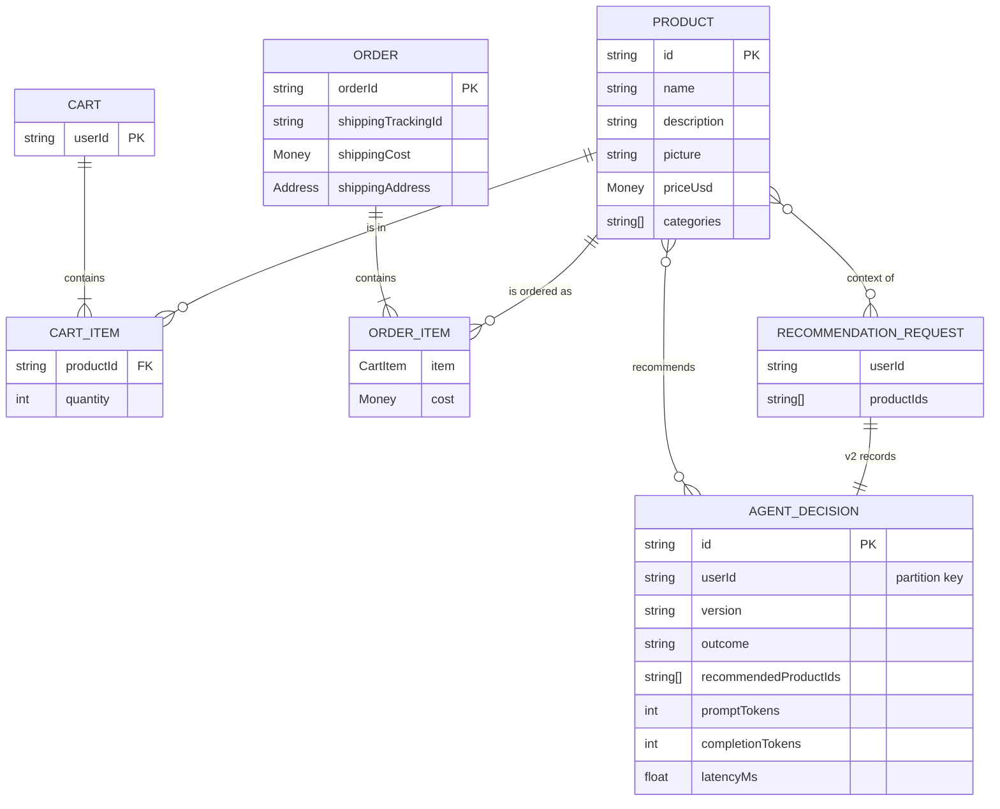

# Data model

Part 1 describes the data Online Boutique already has. Part 2 describes the
data our AI agent (recommendationservice v2) adds. The interfaces are the
protobuf messages in
[`online-boutique/protos/demo.proto`](../online-boutique/protos/demo.proto);
v2 keeps them unchanged.



## 1. Existing data (Online Boutique)

| Data | Owner service | Where it is stored | Shape |
|---|---|---|---|
| **Products** | productcatalogservice | JSON file baked into the image ([`catalog/productcatalogservice/products.json`](../catalog/productcatalogservice/products.json)); read-only | `Product { id, name, description, picture, priceUsd: Money, categories[] }`. We extended the catalog from 9 to 200 products in 24 categories so recommendations can be meaningful |
| **Carts** | cartservice | **Redis** (key-value), a sidecar container in the same Container App | Key = `userId`; value = `Cart { userId, items: CartItem { productId, quantity }[] }` |
| **Money** | (shared type) | — | `Money { currencyCode, units, nanos }`: whole units plus billionths, which avoids floating-point rounding |
| **Currency rates** | currencyservice | JSON file in the image; read-only | Currency code → rate against EUR |
| **Orders** | checkoutservice | **Not stored.** The order is built, charged (paymentservice, mock), and sent by email (emailservice, mock) | `OrderResult { orderId, shippingTrackingId, shippingCost, shippingAddress, items: OrderItem { item, cost }[] }` |
| **Ads** | adservice | In memory, hard-coded | `Ad { redirectUrl, text }` by category |
| **Session** | frontend | Browser cookie | `shop_session-id` (becomes the `userId`) and the chosen currency |

**The recommendation interface (same for v1 and v2):**

```
ListRecommendationsRequest  { user_id: string, product_ids: string[] }   // product being viewed + cart
ListRecommendationsResponse { product_ids: string[] }                    // up to 5, none from the request
```

v1 keeps no state: it reads the catalog and returns up to 5 random products
that are not in the request.

## 2. Data added by the AI agent (v2)

### Decision records: Cosmos DB (NoSQL)

Every v2 response writes one JSON document. These records are the agent's
audit trail and the source of the canary's latency, correctness and cost
measurements.

- **Account:** free tier, 400 RU/s shared database throughput, region West US 2
- **Database / container:** `recommendations` / `agent-decisions`
- **Partition key:** `/userId`. Queries by shopper stay in one partition, and
  many shoppers spread the load.
- **TTL:** 30 days. Records delete themselves, so storage stays inside the
  free tier.
- **Writes:** asynchronous, on a background queue, so a slow or failed write
  never delays a recommendation.

| Field | Type | Meaning |
|---|---|---|
| `id` | string (UUID) | Document ID |
| `userId` | string | Shopper (session ID), partition key |
| `timestamp` | ISO 8601 | When the decision was made |
| `version` | string | `v2` |
| `contextProductIds` | string[] | Request input: product viewed + cart |
| `recommendedProductIds` | string[] | Response output (what the shop showed) |
| `outcome` | string | `agent` (the model decided), `cached` (a recent model decision reused), `fallback` (random picks, like v1) |
| `fallbackReason` | string | Why the model's answer was not used (timeout, error, invalid picks) |
| `reason` | string | The model's one-sentence explanation |
| `toolCalls` | object[] | Tools the model called, with their arguments |
| `steps` | int | Number of model calls in this decision |
| `toppedUp` | int | Products added at random when the model returned fewer than 5 valid ones |
| `model` | string | e.g. `openai/gpt-oss-20b` |
| `promptTokens`, `completionTokens` | int | Model usage (the cost driver) |
| `estimatedCostUsd` | float | Tokens × configured price ($0 on Groq Free) |
| `latencyMs` | float | Time to answer the request |

Example (shortened):

```json
{
  "userId": "1169daaa-…", "version": "v2",
  "contextProductIds": ["6E92ZMYYFZ"],
  "recommendedProductIds": ["LY74IV7XCL", "684WL1019Y", "RVI46LGB4I", "1UVIARBLYI", "8Y9DNUN3Q4"],
  "outcome": "agent", "reason": "Complementary coffee brewing tools for a mug owner",
  "model": "openai/gpt-oss-20b", "promptTokens": 622, "completionTokens": 122, "latencyMs": 339.0
}
```

The same record is also written to the service log as one JSON line, which
Log Analytics collects for the [canary dashboard](../infra/azure/dashboard.bicep).

### Agent context (not stored)

v2 does not keep a conversation. Each request is a single, stateless
exchange with the model:

- **Input context, built per request:** the products in the request, the
  store's categories, and a shortlist of 12 related candidates from the
  catalog.
- **Tools the model may call:** `browse_category`, `search_catalog`,
  `get_products`, and `recommend` (the final answer). On Azure the agent runs
  in single-step mode: the model calls `recommend` directly from the
  shortlist.
- **Guardrails** check every proposed ID against the catalog, remove
  duplicates and the request's own products, and cap the list at 5. If the
  answer is invalid or late, v2 falls back to random picks.

### Decision cache (in memory)

| Key | Value | Lifetime |
|---|---|---|
| Sorted `contextProductIds` | Recommended IDs + the model's reason | 10 minutes, at most 256 entries, per replica |

The same product and cart within 10 minutes reuse the model's answer
(`outcome: cached`). In the canary run, 210 of 269 v2 requests were served
from the cache; see the [cost report](cost-report.md).

## Where each requirement is met

| Requirement | Met by |
|---|---|
| Document the existing data model | Part 1 |
| Document the data added for the AI agent (agent context, state) | Part 2: decision records, agent context, cache |
| NoSQL data store | Cosmos DB `agent-decisions` (managed NoSQL, free tier); the cart stays on Redis |
